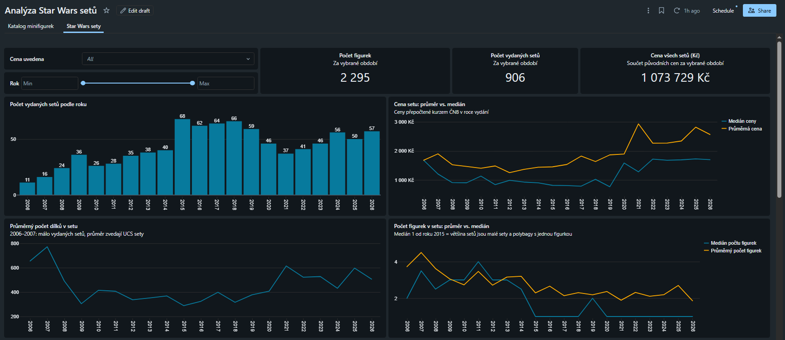
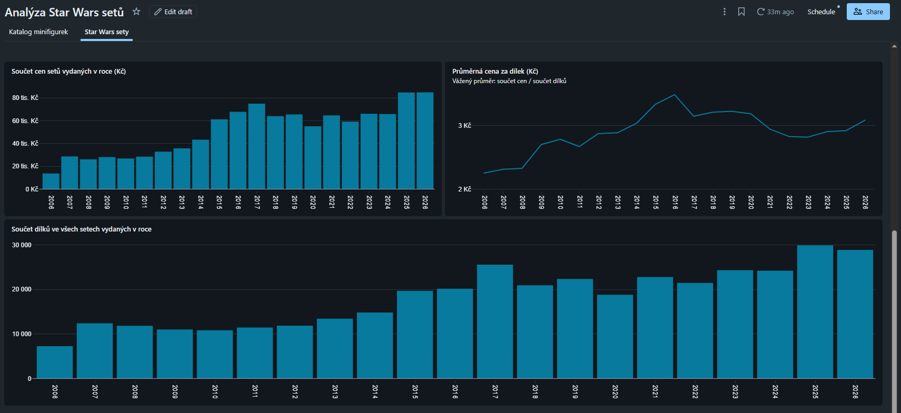
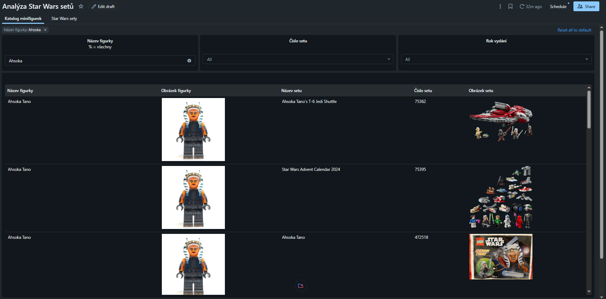

# LEGO Sets Analytics – Databricks Medallion Pipeline

End-to-end data pipeline on Databricks that ingests LEGO set data, cleans and joins it using the medallion architecture (bronze → silver → gold), and serves it to an AI/BI dashboard.

- **Medallion architecture** on Databricks – Unity Catalog, Delta Lake, PySpark & SQL
- **4 data sources** – Rebrickable API, Brickset API, Rebrickable CSV export, Czech National Bank FX rates
- **Daily orchestrated job** – 10 tasks with dependencies, parallel ingestion, retries, data quality tests
- **AI/BI dashboard** – price and size trends of Star Wars sets + searchable minifigure catalog

**Scope:** the pipeline covers Star Wars, Ninjago (up to 2013) and Botanical Collection sets; the dashboard focuses on Star Wars.

**Questions the dashboard answers:**
- How have set prices, piece counts and price per piece of Star Wars sets evolved over time?
- Is the typical set getting more expensive, or are a few large sets pulling the average up?
- How much does the price of a set rise with the number of minifigures – and is it more than just the set size?
- In which sets does a given minifigure appear?

## Dashboard

**Star Wars sets** – number of sets, price (average vs. median), pieces and minifigures per year




**Minifigure catalog** – search a minifigure and see every set it appears in



> Column names are in Czech. Key terms: *cena* = price, *dílky* = pieces, *figurky* = minifigures, *téma* = theme, *rok vydání* = release year.

## Key findings (Star Wars, 2006–2026)

1. **The typical set nearly doubled in price** – median price rose from **907 Kč** (2008–2019) to **1 710 Kč** (2021–2026). The jump happened around 2020 (median 770 Kč in 2019 → 1 586 Kč in 2020) and has stayed at ~1 700 Kč since 2022.
2. **…but bricks did not get more expensive** – the weighted price per piece stayed flat (**3.05 Kč → 2.92 Kč**), while the average set grew from **354 to 527 pieces (+49 %)**. Sets cost more because they are bigger.
3. **Price per piece peaked in 2016** at 3.49 Kč and has been between 2.8 and 3.1 Kč since 2021.
4. **A few large sets pull the average up** – in 2021–2026 the average price (2 525 Kč) is ~48 % above the median, driven by Ultimate Collector Series sets. The median is the better measure of a typical set.
5. **Minifigures do not add a price premium** – sets with more minifigures cost more (median 275 Kč with 1 minifigure vs. ~2 500 Kč with 6+), but the price per piece is 2.7–3.1 Kč in every group. More minifigures simply come with bigger sets.
6. **Output quadrupled** – total pieces released per year grew from 7 205 (2006) to 29 847 (2025); the number of sets peaked in 2015–2018 (62–68 sets per year).

> All prices are nominal CZK, not adjusted for inflation. Since the price per piece stayed flat while general prices rose, bricks actually got cheaper in real terms.


## Architecture

```
Rebrickable API ─┐
Brickset API ────┼─► BRONZE (raw) ─► SILVER (cleaned, joined) ─► GOLD (dashboard tables) ─► Dashboard
Rebrickable CSV ─┤
ČNB FX rates ────┘
```

| Layer | Schema | Tables |
|---|---|---|
| Bronze | `lego_bronze` | `rebrickable_sets`, `brickset_sets`, `rb_inventories`, `rb_inventory_minifigs`, `rb_minifigs`, `cnb_fx_rates` |
| Silver | `lego_silver` | `lego_sets`, `set_minifigs`, `set_minifig_counts` |
| Gold | `lego_gold` | `sets_dashboard`, `sets_overview`, `theme_year_stats`, `theme_summary`, `sets_minifig_price`, `price_by_minifig_count`, `minifig_price_effect`, `minifigs_in_sets`, `minifigs_catalog` |

## Notebooks

| Notebook | Layer | Description |
|---|---|---|
| `00_setup_schemas` | – | Creates bronze/silver/gold schemas (idempotent) |
| `10_bronze_rebrickable_sets` | Bronze | Sets from Rebrickable API (paginated, rate-limit aware, retry on 429) |
| `11_bronze_brickset_sets` | Bronze | Sets incl. retail prices (EUR/USD) from Brickset API, raw JSON kept |
| `12_bronze_rebrickable_minifigs` | Bronze | Minifigure inventories from Rebrickable daily CSV export (no API rate limit) |
| `13_bronze_cnb_fx_rates` | Bronze | Daily CZK exchange rates from the Czech National Bank (1999 – today) |
| `20_silver_lego_sets` | Silver | Typed, deduplicated sets joined with prices, converted to CZK + data quality checks |
| `21_silver_set_minifigs` | Silver | Minifigures per set (counting quantities, not just distinct figures) |
| `30_gold_dashboard_tables` | Gold | Set details, theme × year stats, theme KPIs |
| `31_gold_minifig_price` | Gold | Price vs. minifigure count (linear regression per theme), sets overview, minifigure catalog |
| `40_data_quality_tests` | Tests | 28 data quality checks across all layers; fails the job if any check fails |

Numbering by tens leaves room for new notebooks within a layer.

## Orchestration

Daily Databricks Job (serverless), 06:00 Europe/Prague:

```
setup_schemas ─┬─► bronze_rebrickable ─┐
               ├─► bronze_brickset ────┴─► silver_lego_sets ─► gold_dashboard ──┐
               ├─► bronze_cnb_fx ──────┘
               └─► bronze_minifigs ──────────────────────────► silver_minifigs ─┴─► gold_minifig_price ─► data_quality_tests
```

- Bronze tasks run in parallel; API tasks have retries configured.
- The minifigure branch is independent – if it fails, the main dashboard tables still refresh.
- `data_quality_tests` runs last and fails the job if any check fails (e.g. duplicate sets, missing sub-themes, FX rate out of range, price coverage drop); a failure triggers an e-mail notification.

## Setup

1. **API keys** – get free keys at [Rebrickable](https://rebrickable.com/api/) and [Brickset](https://brickset.com/tools/webservices/requestkey), then store them as Databricks secrets (never in code):

   ```bash
   databricks secrets create-scope lego
   databricks secrets put-secret lego rebrickable_api_key
   databricks secrets put-secret lego brickset_api_key
   ```

2. **Catalog** – notebooks use the `workspace` catalog. Change `CATALOG` / `USE CATALOG` if yours differs.

3. **Run** – clone this repo as a Databricks Git folder and run notebooks in order `00 → 40`, or create a job with the dependencies above.

## Design decisions

- **Bronze stores raw data as strings** plus ingestion metadata (`_source`, `_ingested_at`); typing happens in silver with `TRY_CAST`, so a malformed value never breaks ingestion.
- **Full theme tree is downloaded** – Rebrickable `theme_id` filter does not include sub-themes (e.g. Star Wars → Ultimate Collector Series), so all descendant themes and themes named after the franchise (e.g. Technic → Star Wars) are queried.
- **Theme is captured at ingestion** (`query_tema`) rather than derived from `theme_id`, which is unreliable when the API returns sub-themes.
- **Deduplication in silver** – Botanical sets are queried through several Brickset theme configurations, so duplicates are removed before the join.
- **Minifigures via CSV export instead of per-set API calls** – reduces runtime from ~25 minutes to seconds.
- **All prices in CZK, converted with the historical rate of the release year** – EUR (DE retail) price first, USD as fallback; yearly average of daily Czech National Bank rates. The source currency and rate used are kept (`cena_czk_zdroj`, `pouzity_kurz`). US prices exclude sales tax while the EUR prices are German retail incl. 19 % VAT, so USD-based prices get +19 % (`pricitana_dph`) to stay comparable.
- **Price per piece next to price** – sets with more minifigures are also bigger, so price per piece partially controls for set size.

## Data limitations

- **Prices only from 2006** – Brickset provides LEGO.com retail prices only from that year; older sets are included in counts and piece statistics, but not in price metrics.
- **Some promotional items are missing** – ~40 Star Wars promo items (gifts with purchase, book and magazine extras, employee gifts) are listed by Rebrickable outside the Star Wars theme tree. They are small, unpriced items, so the impact on the analysis is minimal.
- **Ninjago has USD prices only** – all Ninjago CZK prices are converted from USD with the VAT correction, so they are less precise than EUR-based prices.
- **USD-based prices are approximate** – the +19 % VAT correction was validated on sets with both prices (median ratio EUR/USD-based ≈ 0.95), i.e. USD-based prices are ~5 % higher on average.
- **Current year is incomplete** – yearly totals for the current year grow until the year ends.

## Next steps

- **Incremental loads** – replace full refresh in bronze with incremental ingestion (only new or changed sets) and `MERGE INTO` in silver, keeping history of changes (e.g. ratings over time).
- **Infrastructure as code** – define the job and dashboard with Databricks Asset Bundles, so the whole project deploys with one command.
- **More themes in the dashboard** – Ninjago and Botanical Collection pages; the gold tables already support them.

## Tech stack

Databricks (Unity Catalog, Delta Lake, Jobs, serverless compute, Dashboards) · Python · PySpark · SQL · REST APIs

## Data sources

- [Rebrickable](https://rebrickable.com/) – sets, themes (API), minifigure inventories (CSV export)
- [Brickset](https://brickset.com/) – retail prices, ratings
- [Czech National Bank](https://www.cnb.cz/) – CZK exchange rates

LEGO® is a trademark of the LEGO Group, which does not sponsor or endorse this project.
